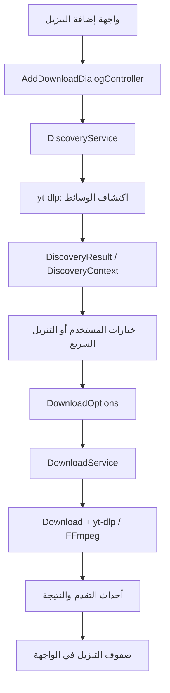

# دليل فهم BearDL وسجل الكوميتات الـ22

هذه وثيقة لفهم المشروع وتاريخ التعديلات، وليست إذنًا بتغيير الكود أو رفعه. اقرأ [الحالة الموحدة وخطوات الاستمرار](CURRENT_TASK.md) لمعرفة الطلب والإذن والمشكلات المعلّقة، و[مراجعة الموارد](RESOURCE_REVIEW_2026-10-14.md) للقياسات. لا تنسخ حالة التسليم إلى هذا الدليل التاريخي.

## ابدأ بهذه الخطوات

1. المستودع داخل مجلد `BearDL/` الداخلي. إذا بدأت من المجلد الخارجي، انتقل إلى `BearDL/` قبل أوامر Git. جميع مسارات الملفات في هذا الدليل نسبية من جذر المستودع؛ لا تذكر مسارات جهاز المستخدم في التوثيق.
2. اقرأ `AGENTS.md` ثم `docs/CURRENT_TASK.md` ثم `docs/RELEASING.md`. عند اختلاف معلومات قديمة وحديثة، استخدم أحدث طلب مباشر من المستخدم والحالة المحدثة، ولا تعتبر إذنًا سابقًا إذنًا دائمًا.
3. افحص `git status --short` و`git diff` و`git log -1 --oneline` و`git remote -v`. لا تعمل reset أو checkout لاستبدال ملفات فيها عمل محلي.
4. الهدف الافتراضي `2-sa/BearDL`، وremote اسمه `origin`. المشروع الأصلي `NickvisionApps/Parabolic` مرجع، وليس جهة رفع تعديلات هذا الفرع.
5. لا تثبّت SDK أو أدوات أو شهادات محليًا دون إذن. لا تعمل كوميت أو رفع أو إصدار جديد لمجرد أن هذه الوثيقة تشرح أوامره؛ اتبع الإذن الساري.

## ما البرنامج؟

BearDL واجهة لـyt-dlp لتنزيل الوسائط، مشتقة من Parabolic. يتعامل yt-dlp مع المواقع واكتشاف صيغ الوسائط والتنزيل، ويستخدم التطبيق FFmpeg للمعالجة والدمج والتحويل بحسب الخيارات، واعتمادات أخرى مثل Deno وaria2c عند الحاجة. لا تحاول إصلاح كل خطأ تنزيل بتغيير تصميم XAML؛ قد يكون السبب في الموقع أو yt-dlp أو المصادقة أو خيارات المعالجة.

أسماء المشاريع والمعرّفات `Nickvision.Parabolic.*` و`org.nickvision.tubeconverter` موروثة. وجود اسم Parabolic في كود أو إعداد ليس مبررًا لإعادة تسميته عشوائيًا؛ قد يؤثر ذلك في التخزين أو URI أو الموارد أو مسار تحديثات التطبيق.

هدف الفرع الأساسي واجهة عربية سليمة واتجاه RTL في Windows، مع إصدار حزم للمنصات الثلاث. الترجمة وحدها لا تحقق ذلك، ونجاح بناء المنصات كلها لا يعني أن كل تعديل واجهة وصل إليها كلها.

## خريطة الملفات

| المسار | دوره | متى تبدأ منه؟ |
| --- | --- | --- |
| `Nickvision.Parabolic.Shared/Controllers` | التنسيق بين الواجهات والخدمات والخيارات | سلوك التنزيل أو الإعدادات أو السجل المشترك |
| `Nickvision.Parabolic.Shared/Services` | الاكتشاف والتنزيل والسجل والاستعادة والأحداث والأدوات | شبكة، عمليات خارجية، تخزين، تكرار، تزامن |
| `Nickvision.Parabolic.Shared/Models` | بيانات الوسائط والخيارات والحالات | إضافة خاصية مشتركة أو فهم البيانات الممررة |
| `Nickvision.Parabolic.Shared/Helpers` | تسجيل الخدمات، امتدادات الإعدادات، وصف JSON | إعداد جديد أو هوية التطبيق أو DI |
| `Nickvision.Parabolic.WinUI` | Windows: XAML وعناصره وكود خلفي | قصّ النص، اتجاه، زر، نافذة، منتقي ملفات Windows |
| `Nickvision.Parabolic.GNOME` | GTK/libadwaita على Linux **وmacOS**؛ ملفات Blueprint وكود C# | عنصر واجهة أو مشكلة تشغيل GTK على المنصتين |
| `resources/po/ar.po` | ترجمة عربية مشتركة بواسطة gettext | صياغة عربية؛ استخدم مهارة `arabic-ui` |
| `resources/yt-dlp-plugins` | إضافات الاستخراج المجمّعة مع التطبيق | تعديل استخراج خاص بموقع |
| `.github/workflows` | اختبارات وبناء وإصدار | فشل CI أو طريقة توزيع أو رقم إصدار |
| `resources/macos` و`resources/linux` و`flatpak` و`inno` | تغليف وتشغيل وحزم لكل نظام | ملفات مفقودة أو مسارات تحميل أو مثبتات |
| `extension` | إضافة المتصفح لإرسال الروابط | إرسال رابط من المتصفح إلى التطبيق |
| `tests` و`docs` | فحوص ودلائل الاستمرار | تحقق من التعديل وتسليم السياق للمحادثة التالية |

الحل هو `Nickvision.Parabolic.slnx`، والمشاريع الأساسية .NET 10. المكتبات `Nickvision.Desktop.*` وGirCore ليست كلها كودًا محليًا في هذا المستودع؛ افحص المصدر أو وثائق الإصدار المعني عند الحاجة، ولا تفترض أن أي API موجود في إصدار آخر متاح هنا.

## كيف يبدأ التطبيق؟

- Windows يبدأ من `Nickvision.Parabolic.WinUI/Program.cs`، ثم `ConfigureParabolic` و`ConfigureWinUI<App>`، ويُظهر `App.xaml.cs` النافذة الرئيسية عبر الخدمات المسجلة.
- GTK يبدأ من `Nickvision.Parabolic.GNOME/Program.cs`، ثم `ConfigureParabolic` و`ConfigureAdw<MainWindow>`.
- `Shared/Helpers/HostApplicationBuilderExtensions.cs` يحدد `AppInfo` ومسار المستودع ومصدر التحديثات ويسجل الخدمات والمتحكمات.
- إعدادات البرنامج مبنية على `IConfigurationService` من مكتبة Desktop؛ خصائص BearDL موجودة في `IConfigurationServiceExtensions.cs`. إعداد جديد يحتاج خاصية هنا، ووصولًا من المتحكم، وعناصر قراءة وحفظ في الواجهتين. لا تكفي إضافة Toggle في XAML.

## كيف ينتقل الرابط إلى ملف؟



- **الطريق العادي:** إدخال الرابط، ثم الاكتشاف، ثم اختيار الجودة والترجمة والخيارات، ثم إنشاء `DownloadOptions` وإضافتها.
- **الطريق السريع:** يغلق صفحة الرابط ويجهز الخيارات في الخلفية دون صفحات الجودة؛ لا تستنتج أنه يتجاوز المصادقة أو فحوص الأخطاء. التحسين الأحدث يحد تجهيز طلباته المتزامنة باثنين.
- **ملف الروابط أو قائمة التشغيل:** يُكتشف كل عنصر وتُنشأ خياراته. افحص وجهة العنصر والعنوان والترقيم وترتيب العناصر، ولا تفترض أنه تنزيل واحد فقط.
- **DownloadService:** يحتفظ بالجاري والمنتظر والمكتمل، ويحترم حد التنزيلات النشطة، ويستخدم السجل والاستعادة. لا تخلط بين حد التنزيلات وحد عمليات اكتشاف الروابط.
- **EventsService:** ينقل أحداث الخدمات إلى الواجهات. تحديث عناصر WinUI يجب أن يكون على Dispatcher؛ وGTK يستخدم مسار GLib الموجود في الواجهة. لا تغيّر عنصر UI من خيط عامل دون هذا المسار.
- **HistoryService:** سجل الروابط والعنوان والمسار والتاريخ. السجل ليس إثباتًا أن الملف ما زال موجودًا؛ فحص التكرار الأحدث يتحقق من القرص. مدة السجل وحذفه تؤثران في إمكان اكتشاف الملفات السابقة.
- **RecoveryService:** بيانات لاستعادة التنزيلات بعد تعطل التطبيق. ليست السجل نفسه.
- **ThumbnailService:** الصور وخرائطها وكاشها. يُستخدم أيضًا في صفوف التنزيل، وليس فقط في صفحة الاكتشاف؛ لا تحذف الخرائط باعتبارها غير مستخدمة في الوضع السريع.

## الكوميتات الـ22 بالترتيب

النطاق المقصود تحديدًا هو `1118e6a3..567a9e37`: يستبعد نقطة البداية الأصلية `1118e6a3` ويضم 22 كوميتًا بعدها. أحدها كوميت دمج؛ ليس كل سطر ميزة جديدة مستقلة. أوصاف هذه القائمة مستخرجة من سجل Git وفرق الملفات، ولا تثبت نجاح كل محاولة تاريخية أثناء التشغيل.

### 01 — `98cbdfd5`: اتجاه الواجهة حسب اللغة

أضاف `LocalizationHelper` وطبّق اتجاه اللغة على نوافذ وصفوف WinUI. أبقى الحقول التقنية وبعض الصور LTR، ونظّم إرشادات المستودع وتعديلات مرتبطة ببناء Windows. هذا أساس RTL، لكنه لم يُنهِ كل مشكلات القصّ والمفاتيح؛ جاءت إصلاحات لاحقة.

### 02 — `653c1bf6`: إزالة تكرار تشغيل Windows يدويًا

حذف تعريف تشغيل يدوي مكرر في `.github/workflows/windows.yml`. هذا إصلاح إعداد workflow، وليس تغييرًا في استهلاك موارد التطبيق أثناء التشغيل.

### 03 — `fd841561`: إصلاح استيراد مساعد الترجمة

أضاف using المطلوب لـ`LocalizationHelper` في `Controls/AboutDialog.xaml.cs`. لا توجد ميزة UI إضافية؛ أصلح ربط الملف بالمساعد أثناء التجميع.

### 04 — `f6cbffbb`: أزرار النافذة والخيارات في العربية

أعاد ترتيب شريط العنوان وأضاف أزرار نافذة عربية على اليسار مع معالجة الإغلاق والتصغير والتكبير، وحسّن صفوف خيارات إضافة التنزيل. أضاف نسخة ترجمة المثبت `inno/Languages/Arabic.isl` ودعمها في `setup.iss`. لا تعكس كل أيقونة؛ اعكس ما يدل على اتجاه فقط.

### 05 — `46693203`: تأكيد الإغلاق عند وجود تنزيلات

صحح مسار زر الإغلاق المخصص حتى يحترم تأكيد إغلاق التطبيق أثناء وجود تنزيلات، بدل تجاوز معالجة الإغلاق الأصلية. حافظ على هذا السلوك عند تعديل أزرار العنوان.

### 06 — `833f418e`: التنزيل السريع والإصدارات متعددة المنصات

أضاف إعداد FastDownload، وطريق تجهيز التنزيلات في الخلفية، وخيار UseBestQuality، ودعم الواجهة في Windows وGTK. ربط هوية التحديثات بالمستودع الفرعي، وأضاف `release.yml` ورقم الإصدار المشترك والحزم متعددة المنصات. احتوى أيضًا تحسينات واسعة في RTL وصفوف الخيارات والتمرير. تكلفة عمليات التجهيز المتزامنة غير المحدودة عولجت لاحقًا في مراجعة الموارد؛ لا تعد استخدام أعلى جودة مساويًا في الموارد لاستخدام جودة أدنى.

### 07 — `0365c66a`: دمج عمل فرع RTL

دمج PR رقم 1 من `2-sa/coxde/winui-rtl`. يثبت إدخال تاريخ الفرع إلى `main`؛ لا تنسب إليه ميزة إضافية لمجرد أنه كوميت مستقل ضمن العدد.

### 08 — `25ab33b5`: ملفات تحميل الماك ومصادر Linux

صحح مسار حزمة `.app`، ونسخ ملفات الأيقونات وpixbuf مع تتبع الروابط الرمزية لتجنب ملفات مفقودة داخل الحزمة. حدّث مصادر FFmpeg في Flatpak وإعداداتها. هذا مهم للتغليف، لكنه لا يثبت حل كل انهيار تشغيل على الماك.

### 09 — `af0ef935`: الوصول إلى عناصر الحوار قبل عرضه

استبدل الاعتماد على `ToggleSwitch.Parent` بعناصر صفوف مسماة في حوار إضافة التنزيل. قبل إرفاق العنصر بالشجرة قد لا يكون Parent جاهزًا؛ لذلك لا تُعد استخدامه لإخفاء صفوف التنزيل المباشر أثناء تجهيز الحوار.

### 10 — `5c6ba63d`: استخراج الترجمات المتاحة

أضاف extractor الخاص بـ`xhamster_subtitles` من بيانات المشغّل التي جلبها yt-dlp، مع الفصل بين الترجمات الأصلية والمولّدة. أضاف اختبارات `tests/plugins` ومسار `plugins.yml` وربطه ببناء الإصدار. لا يُنشئ ترجمات غير موجودة على المصدر.

### 11 — `01d2247d`: منع امتداد محتوى الحوار خارج العرض

قيّد عرض حوار إضافة التنزيل ومحتواه، وأضاف فحص PowerShell للحدود المرئية في `tests/windows/Verify-DownloadDialogLayout.ps1`. فحص هذا الملف ليس بديلًا عن تجربة النسخة المثبتة وتصويرها.

### 12 — `e1a1d2e3`: صياغة العربية وثبات حجم الحوار

أعاد صياغة ترجمات كثيرة في `resources/po/ar.po`، وحسّن قيود حجم حوار التنزيل عند الانتقال بين صفحات التهيئة. بقيت بعض الصياغات محل اعتراض لاحق؛ منها «في قائمة الانتظار» التي صارت «بانتظار التنزيل» في التسليم الأحدث.

### 13 — `735ab68b`: محاولة أولى لاتجاه مفاتيح التشغيل

ربط FlowDirection لمفاتيح إضافة التنزيل والإعدادات باتجاه الصفحة بدل LTR الثابت. هذا وصف لمحاولة تاريخية، وليس النتيجة النهائية المعتمدة. جاء helper للانعكاس ثم تهيئة C# مباشرة لاحقًا؛ لا ترجع إلى هذه المحاولة بحجة تبسيط الكود.

### 14 — `cee4464b`: فحص تحديث يدوي حديث

أضاف `RefreshAppReleaseCache` لمسح كاش قائمة إصدارات الفرع قبل الفحص اليدوي، لتجنب رسالة عدم وجود تحديث رغم نشر إصدار جديد. لا يمسح الكاش مع كل عملية أو بشكل دوري؛ المسح مقصود عندما يطلب المستخدم فحصًا يدويًا.

### 15 — `139ffbb3`: أحجام مراحل الحوار ومناطق السحب

أضاف `SetViewport` لأحجام مراحل الرابط والاكتشاف والتهيئة، وقيد صفحات ViewStack غير المعروضة أيضًا. أضاف `UpdateTitleBarInputRegions` لجعل الفراغ في العنوان قابلًا للسحب مع بقاء القوائم والأزرار قابلة للنقر. جرى تحسين تكلفة أحداث التخطيط لاحقًا دون الاستغناء عن فحص مناطق WinUI الأصلية.

### 16 — `6ec012fe`: بطاقات حسابات الدخول وزر الإضافة

أزال عرض 500 والهوامش السالبة من بطاقات Keyring، ومدّ العناصر إلى العرض المتاح، ولفّ العناوين والروابط، وحسّن محاذاة زر الإضافة بحسب اللغة. لا تعِد المقاسات الثابتة التي تسبب قصّ الجانب العربي.

### 17 — `4af00e7c`: تقييد عرض محتوى التمرير

أضاف `ScrollViewportHelper.ConstrainContentWidth` وطبقه على السجل والإعدادات وحسابات الدخول. يقيس المساحة المتاحة بعد padding وهوامش المحتوى. التمرير LTR لإبقاء الشريط يمينًا، ومحتواه يعيد اتجاه اللغة. التحسين الأحدث يتجنب كتابة العرض إذا لم يتغير.

### 18 — `824d3d4c`: عناوين الحقول العربية وقصّ نافذة عن البرنامج

فصل عناوين الحقول العربية عن المدخلات التقنية LTR، وأضاف `LocalizationHelper.CreateLabeledInput` للحقول الديناميكية، و`AutomationProperties.LabeledBy` في XAML. قيّد ولفّ محتوى AboutDialog واختصر ترجمة Debugging إلى «التشخيص». لا تجعل حاوية عنوان عربي LTR لمجرد أن داخلها رابطًا.

### 19 — `0b329e31`: انعكاس المفاتيح وإخفاء أسماء المترجمين

أضاف ToggleSwitchHelper مع انعكاس الرسم في العربية دون تغيير قيمة IsOn، وأفرغ `translation-credits` في العربية وفق طلب المستخدم، وحدّث وثائق التسليم. هذه النسخة اعتمدت الربط بخصائص مرفقة؛ فشلت النتيجة المرئية للمفاتيح في النسخة التي اختبرها المستخدم لاحقًا. إزالة أسماء المترجمين لا تشمل تراخيص المشروع أو اعتمادات المطورين والمصممين.

### 20 — `d7ba4bd0`: تقوية إعداد بناء Windows

عطّل كاش MSYS2 على ARM64 بعد فشل paccache، وضبط `fail-fast: false` حتى لا يُلغى x64 بسبب ARM64، وأضاف إعادة محاولة تنزيل FFmpeg. هذا يحسّن CI؛ لا يضيف برنامجًا يعمل في الخلفية على جهاز المستخدم.

### 21 — `9674570b`: تهيئة اتجاه المفاتيح مباشرة

استبدل اعتماد ElementName داخل صفحات ViewStack غير المعروضة باستدعاء `ToggleSwitchHelper.Apply` مباشرة بعد الترجمة. شمل مفاتيح إضافة التنزيل والإعدادات، ويستخدم ScaleX سالبًا للعربية وموجبًا للإنجليزية. الأرقام التاريخية كانت 12 و18 مفتاحًا؛ صار هناك إعداد جديد للتكرار في التسليم الأحدث، لذلك افحص كل مفتاح جديد بدل الاعتماد على العدد القديم. نجاح المصدر والبناء لا يحسم اتجاه الدائرة بصريًا.

### 22 — `567a9e37`: حزم DMG للماك

أضاف إنشاء `BearDL-macOS-arm64.dmg` ونسخة x64 مع رابط Applications، وفحص الصورة والتوقيع، وأدرجهما ضمن artifacts وملفات الإصدار وبصمات SHA256، مع إبقاء ZIP. نُشر في 2026.5.116. لا تعتبر التحول من ZIP إلى DMG إصلاحًا لانهيار البرنامج.

## ما حدث بعد الكوميتات الـ22؟

هذه التغييرات خارج النطاق التاريخي السابق، ويجب عدم نسبتها إلى الكوميتات الـ22:

- `fcc9d3e8`: إغلاق الإشعارات بعد خمس ثوانٍ، واختيار مجلد التنزيل السريع من صفحة الرابط، وتحسين الصياغة العربية، وفحص تكرار التنزيل مع إعداد لتعطيله، واختبارات الكاشف والموارد، وتحسينات استعلام السجل والتزامن والتخطيط، ووثائق التسليم.
- `bab225fe`: أعاد `using System.IO` المطلوب لـPath بعد أن كشف CI حذفه أثناء مراجعة الموارد. أُلغي بناء 2026.5.117 واستُبدل ببناء 2026.5.118.
- هذا الدليل وتحديثات نتيجة البناء اللاحقة محلية عند كتابتها. افحص Git و`CURRENT_TASK.md` لمعرفة أي تسليم تالٍ؛ لا تبدأ بناءً جديدًا من أجل توثيق حالة بناء فقط.

## قواعد تمنع تكرار الأخطاء

1. إذا طلب المستخدم ميزة لكل البرنامج، افحص Shared والواجهتين. تعديل WinUI لا ينتقل تلقائيًا إلى macOS/Linux.
2. إذا اقترحت ميزة، ابحث عن تنفيذها أولًا. فتح الملفات والمجلدات، والإيقاف والاستئناف وإعادة المحاولة، واختيار عناصر القوائم، والقصّ، والترجمات وحد السرعة موجودة أصلًا.
3. إذا أضفت إعدادًا، افحص القيمة الافتراضية، وقراءته، وحفظه، والواجهة العربية، واتجاه المفتاح، وسلوك إعادة التشغيل على الواجهتين.
4. لا تعتمد على Parent أو الربط داخل صفحة مخفية قبل إرفاقها بالشجرة. افحص توقيت التهيئة فعليًا.
5. لا تفتح ContentDialog آخر فوق الأول في WinUI. راجع الإغلاق الفعلي والتزامن والتوقف، لا مجرد استدعاء Hide.
6. لا تستخدم قراءة السجل الكامل لفحص رابط واحد. الاستعلام الأحدث مخصص لروابط الطلب ويستفيد من فهرس URL.
7. لا تضف حلقات فحص أو مؤقّتات دائمة لمشكلة تحدث عند حدث محدد. المؤقّت الحالي للإشعارات واحد وغير متكرر؛ انتظار التأكيد بالأحداث.
8. لا تستنتج سبب انهيار الماك من الصورة العامة أو من SIGABRT وحده. التقرير الحالي غير مفكوك الرموز، ولا يظهر الإصدار؛ ننتظر رسالة Terminal الأصلية. التفاصيل في وثيقة التسليم.
9. لا تخلط بين ثلاثة مستويات: فرق المصدر صحيح؛ CI نجح؛ واجهة النسخة المثبتة سليمة. أعلن فقط المستوى الذي تحققت منه.
10. حدّث `CURRENT_TASK.md` بعد تقدم مهم. سجّل المشكلة وما تغير وما اختُبر وما بقي مجهولًا، مع الكوميت والبناء المعنيين.

## أوامر للرجوع إلى الدليل الحقيقي: Git

تنفّذ من المستودع الداخلي، وهي للقراءة:

```sh
git log --reverse --oneline 1118e6a3..567a9e37
git show --stat 9674570b
git show 9674570b -- Nickvision.Parabolic.WinUI/Helpers/ToggleSwitchHelper.cs
git diff 1118e6a3..567a9e37 -- Nickvision.Parabolic.Shared
git status --short
git diff --check
```

إذا خالف الكود الحالي وصفًا تاريخيًا هنا، اقرأ الكوميتات الأحدث؛ لا تعِد الكود إلى الوصف القديم. نطاق الـ22 ثابت لشرح التاريخ، أما الحالة التشغيلية والطلب الحالي فمرجعهما `CURRENT_TASK.md`.
